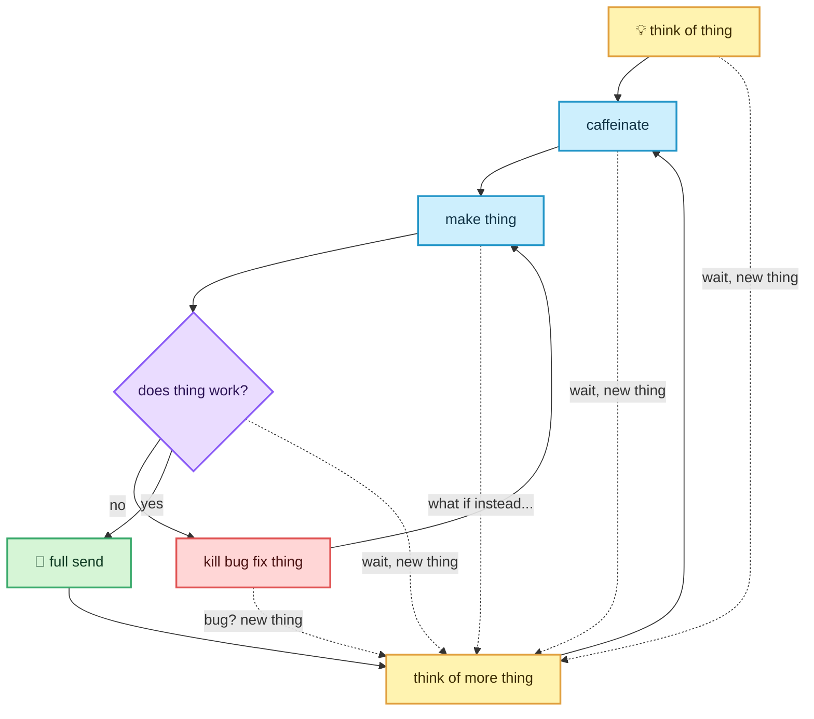

Hey! I'm Mikey, and I code things sometimes!

Here's the very scientific process:

<!---
magic-mikey/magic-mikey is a ✨ special ✨ repository because its `README.md` (this file) appears on your GitHub profile.
You can click the Preview link to take a look at your changes.
--->
